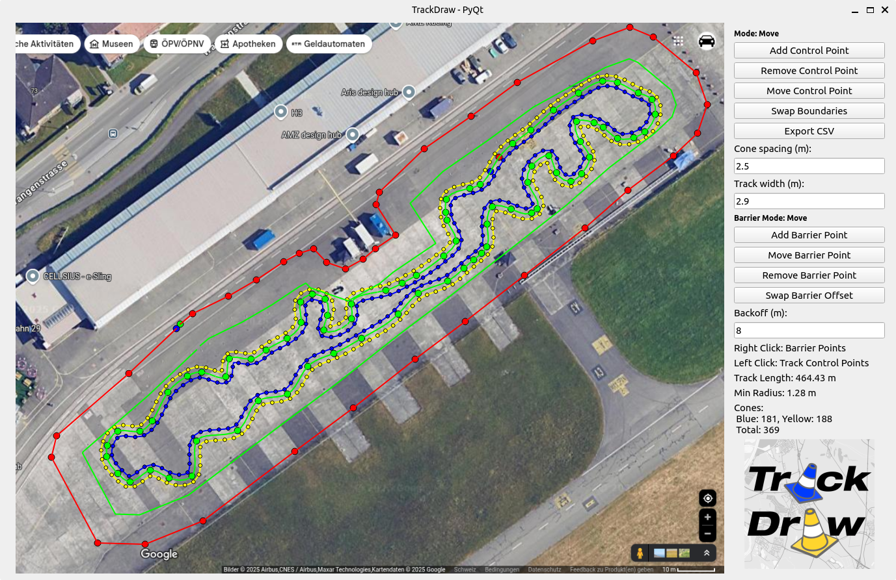

# FS Trackdraw

FS Trackdraw is a tool designed to help draw driverless racing tracks on 
top of satellite images (you can also use a white image if you don't need the "real-world context"). The tracks can be exported in CSV format for a 2D simulator. 
This tool allows you to define the centerline, trackwidth, and the distance between 
consecutive cones. It also lets you draw a barrier of the available space onto the image.

## FS-AI cone colors and portable export

The Editor's **Cones** tool can add, move, and remove four distinct cone types:

| Editor choice | CSV/JSON tag | Competition meaning |
| --- | --- | --- |
| Blue (left) | `blue` | Left track boundary (small cone) |
| Yellow (right) | `yellow` | Right track boundary (small cone) |
| Small orange | `orange` | Entry/exit lanes |
| Big orange | `orange_big` | Before/after timing, start, and finish lines |

This follows **FS-AI Dynamic Events Setup and Cones Specification,
DE6.3.1**. These marker roles are chosen by the designer; Trackdraw does
not automatically invent a start/finish line, entrance, exit, or timekeeper.
Small orange markers are drawn as orange circles and big orange markers as
larger orange circles with a white band. The two sizes remain distinct in
editable project state and exported data.

**Export CSV / Load CSV** retain the original `tag,x,y` column format, with
additional `orange` and `orange_big` rows. **Export JSON / Load JSON** use the
following metric format:

```json
{
  "format": "fs-trackdraw-cones-v1",
  "units": "m",
  "cones": [
    {"tag": "blue", "x": 0.0, "y": 0.0},
    {"tag": "orange", "x": 2.0, "y": 1.0},
    {"tag": "orange_big", "x": 3.0, "y": -1.0}
  ]
}
```

When exporting a complete track, all four types share the same metric frame
anchored at the first centerline point, with the initial centerline tangent as
positive X. Without a centerline, the first blue cone is the origin (else
yellow, then small orange, then big orange), X points right and Y points down
in canvas coordinates. CSV and JSON use the **same** coordinates and tags.
Import recenters all positions together for viewing; it uses only blue/yellow
positions to infer the centerline. At least four blue and four yellow cones
are needed to reconstruct a closed centerline. Sparse or orange-only layouts
remain editable without fabricating that centerline.

Loaded closed tracks preserve blue/yellow boundaries while the shape is
locked, but small and big orange markers remain independently editable.
When the imported layout is moved or rotated, both orange sizes follow the
same transform. Saving a **TrackDraw YAML project** also preserves manually
placed orange markers and the editable positions and types of imported
markers. Older blue/yellow-only CSVs and projects remain supported.



## Feature Ideas
- Randomly generate admissible tracks.
- Load existing CSV-tracks into the satellite image.
- Randomize cone spacings along and normal to the track.

## Getting Started

- Left Mouse Button: Defining the Track (Add, Move, or Remove mode).
- Middle Mouse Button: Panning the image.
- Mouse Wheel: Zooming in on the image.
- Right Mouse Button: Defining the Barrier (Add, Move, or Remove mode).

You can follow the steps below to create your track and use it for simulations.

### Prerequisites

Before starting, ensure you have the following:

1. **Python >=3.10** installed, dependencies in ```requirements.txt```:

   ```bash
   pip install -r requirements.txt
   ```

2. A **Google Maps** screenshot of your location with the scale legend visible. You will need this for drawing the track and scaling.

### Step-by-Step Guide

1. **Screenshot the Location on Google Maps:**
   - Open Google Maps and find the location of the track.
   - Take a screenshot of the area including the scale legend (distance reference).

2. **Calculate Scaling:**
   - Use the scale legend in the screenshot to calculate the scaling factor from **pixels to meters (px/m)**.
   - This scaling factor will be used to convert the pixel-based track drawing into real-world measurements.

3. **Prepare the Location Folder:**
   - Create a folder named after your location in the `/location_images` directory.
   - Inside the folder, place the following files:
     - The **satellite image** (the original Google Maps screenshot).
     - A **config YAML file** containing the image file name and the calculated scaling fraction (px/m).
   
   The folder structure should look like this:
   
   ```
   location_images/
   ├── your_loc/
   │   ├── your_loc_satellite_image.png
   │   └── your_loc_location_name_config.yaml
   ```

   Example content for the YAML configuration file (`your_location_name_config.yaml`):

   ```yaml
   px_per_m: 10.0  # scaling factor (px/m)
   sat_img_path: 'your_loc_satellite_image.png'
   ```

4. **Configure the Main Track Configuration:**
   - Open the `track_config.yaml` file located in the `config/` directory.
   - Set the `standard_location` to match the folder name you created in step 3 (e.g., `your_loc`).
   - You can also adjust the default values for track width, cone distance, and boundary backoff in this configuration file.

   Example configuration (`track_config.yaml`):

   ```yaml
   standard_location: "your_loc"
   track_width: 3.0
   cone_distance: 3.5
   min_boundary_backoff: 10.0
   n_points_midline: 300
   ```

6. **Run the Track Drawing Tool:**
   - Execute the following command to start the track creation tool:

   ```bash
   python src/main.py
   ```

   The tool will load the satellite image and display it on a GUI where you can:
   - Add, remove, and move control points that define the track.
   - Zoom in or pan on your image with the *middle mouse button*.
   - Define the centerline via control points of a cubic spline.
   - Adjust the track width.
   - Using the right mouse button, define an outer barrier as a collection of connected line segments by adding, moving, or removing barrier points.
   - Adjust the cone spacing and boundary backoff interactively.

7. **(Optional) Export the Track as a CSV:**
   - After defining the track, export the track layout as a CSV file. The CSV contains the cone positions along the left and right boundaries, including tags for the cone color.
   - Save the track layout by using the "Export CSV" button in the GUI.
   - The exported CSV can be visualized with `src/plot_csv_track.py`.

   The CSV format will look like this:

   ```csv
   tag,x,y
   blue,2.3,5.1
   yellow,2.5,5.2
   blue,2.7,5.3
   ```

   The coordinates are based on the transformed coordinates from pixels to meters.

### Additional Notes

- **Track Width and Scaling:**
  The `track_width` parameter in the configuration file defines the distance between the left and right boundaries of the track. This value is used to generate the track boundaries based on the centerline.

- **Boundary Backoff:**
  The `min_boundary_backoff` specifies the safe distance from barriers. It ensures that the track is drawn at a sufficient distance away from any barrier.

- **Conversion Factor:**
  Ensure that the scaling factor is correct and yields reasonable distances in the exported .csv file.

### Visualizing the Track

You can visualize the track by plotting the CSV file using the `plot_csv_track.py` script:

```bash
python src/plot_csv_track.py --csv your_exported_track.csv
```

This will display the track layout and allow you to verify the export.

---

By following these steps, you can easily create a track layout on a satellite image and export it for use in a simulator. The tool offers a straightforward way to define racing tracks while considering barriers defined as polygons and visual obstacles defined via the satellite image.
