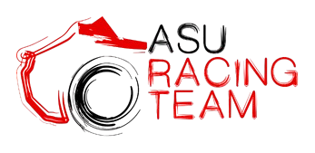

  <h1 align="center">ASURT FSAI Gazebo Simulation</h1>
  
<em>Modular Gazebo Harmonic simulation infrastructure for autonomous Formula Student AI development.</em>

  
  
  
  
  

  
  &nbsp;&nbsp;&nbsp;&nbsp;
  

## Purpose

This repository is the simulation integration layer for ASURT's autonomous Formula Student AI work. It owns Gazebo worlds, vehicle simulation assets, physics and collision configuration, sensor simulation, ROS 2 bridging, spawning, launch orchestration, and simulator validation.

The autonomy software stays outside this repository. Perception, SLAM/localization, planning, and control connect through ROS 2 interfaces so the simulator can support the ASURT stack or another autonomous FSAI racing stack without restructuring the simulator.

## Architecture

    Autonomous FSAI stack
    perception / SLAM / planning / control
                     |
                     | ROS 2
                     v
              fsai_bringup
              launch + bridge
                     |
                   ros_gz
                     |
                     v
              Gazebo Harmonic
              /                 fsai_description      fsai_worlds
       vehicle              maps
                           /
                 fsai_gazebo
            physics + collisions

## Repository Structure

    fsai_description/   vehicle model, geometry, joints and sensor frames
    fsai_worlds/        Silverstone and future Gazebo worlds / track assets
    fsai_gazebo/        physics, collision, tire, suspension and aero configuration
    fsai_bringup/       Gazebo launch, model selection, spawn and ROS-Gazebo bridge
    fsai_sim_tools/     reset, spawn and developer utilities as they are added
    fsai_sim_tests/     integration and simulator validation tests
    docs/               architecture and teammate interface contracts

Silverstone is the first map, not a special case in the architecture. The same applies to the first vehicle. New tracks, vehicles, sensors, and physics models should be addable without changing the repository boundaries.

## Supported Baseline

- Ubuntu 22.04
- ROS 2 Humble
- Gazebo Harmonic (Gazebo Sim 8)
- ros_gz for Humble + Harmonic
- colcon
- ament_cmake

Install the Harmonic-specific ROS/Gazebo integration package on Ubuntu 22.04 / Humble:

    sudo apt install ros-humble-ros-gzharmonic

Use the Harmonic-specific package for this repository instead of changing the simulator baseline.

## Build

    source /opt/ros/humble/setup.bash
    colcon build --symlink-install
    source install/setup.bash

## Run

The stable entry point is intended to be:

    ros2 launch fsai_bringup simulation.launch.py

As Silverstone and the real vehicle land, launch arguments will select the world, vehicle, spawn point, and sensor configuration while this command remains the normal way to start the simulator.

## Branch Workflow

- main — reviewed stable simulator baseline.
- feature/map-silverstone — Silverstone world and map assets.
- feature/vehicle-model — Gazebo vehicle model and vehicle-owned geometry/data.
- integration — simulation lead branch where map + vehicle + spawning + collisions + ROS integration are validated together before promotion to main.

Work should be merged through pull requests. Future feature branches should describe the work rather than the person doing it.

## Team Contracts

Before contributing map or vehicle assets, read:

- [Map interface](docs/map_interface.md)
- [Vehicle interface](docs/vehicle_interface.md)
- [Coordinate frames](docs/coordinate_frames.md)
- [Integration workflow](docs/integration_workflow.md)

Two rules must never be ambiguous:

1. **1 Gazebo unit = 1 metre.**
2. **ROS body convention: +X forward, +Y left, +Z up.**

## Current Milestone

The first milestone is intentionally simple: a world loads, a vehicle spawns, collisions work, the vehicle can be commanded, and state/sensor data can cross the ROS 2 boundary. Visual fidelity comes after that integration pipeline is stable.

## License

GPL-3.0. See [LICENSE](LICENSE).
